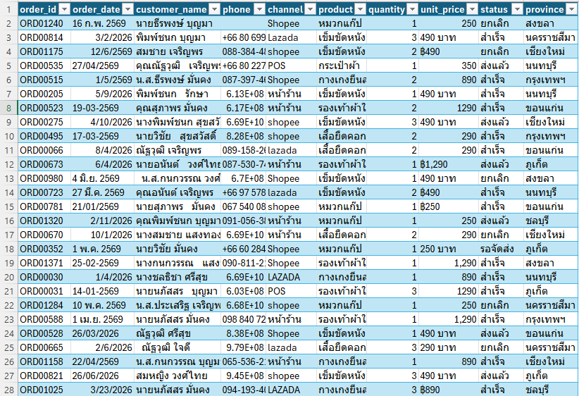
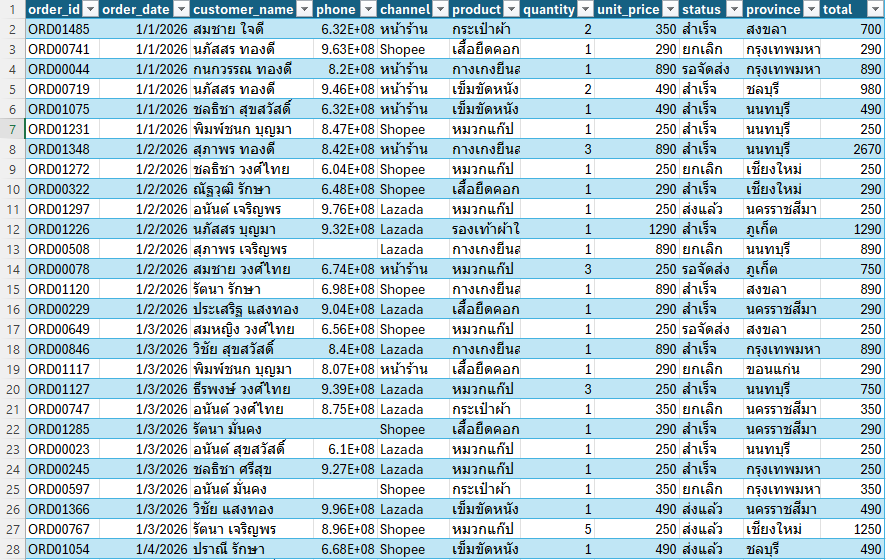
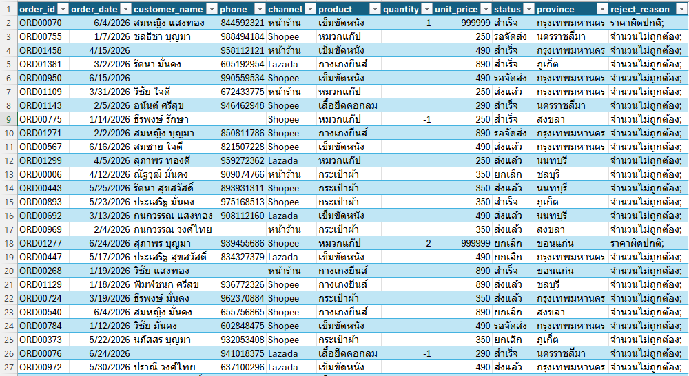

# Sales Data Cleaning Demo

ตัวอย่างการทำความสะอาดข้อมูลยอดขายร้านค้าออนไลน์ที่รวมจากหลายช่องทาง (Shopee / Lazada / หน้าร้าน)

> ข้อมูลทั้งหมดเป็น **ข้อมูลจำลอง** สร้างด้วยสคริปต์ในโปรเจกต์นี้ ไม่มีข้อมูลจริงของบุคคลหรือบริษัทใด

## ปัญหา

ร้านค้าที่ขายหลายช่องทางมักส่งออกข้อมูลมาเป็นไฟล์ Excel/CSV ที่รูปแบบไม่ตรงกัน ทำให้รวมรายงานยอดขายแต่ละครั้งต้องนั่งแก้มือหลายชั่วโมง และตัวเลขผิดพลาดง่าย

ข้อมูลตัวอย่างนี้จำลองปัญหาที่เจอบ่อย:

- วันที่ปนกันหลายรูปแบบ ทั้ง พ.ศ. และ ค.ศ. (`2026-03-02`, `12/06/2569`, `16 ก.พ. 2569`)
- เบอร์โทรหลายฟอร์แมต (`093-758-6368`, `+66 80 699 6054`, ขาดเลข 0 นำหน้า)
- ชื่อช่องทางขายสะกดไม่เหมือนกัน (`Shopee`, `shopee`, `SHOPEE`)
- ราคาปนตัวอักษร (`฿490`, `490 บาท`, `1,290`)
- ชื่อจังหวัดไม่ตรงกัน (`กทม.`, `กรุงเทพฯ`, `กรุงเทพมหานคร`)
- แถวซ้ำจากการส่งออกซ้ำ, ค่าว่าง, จำนวนติดลบ, ราคาผิดปกติ

## ผลลัพธ์

**ก่อน:** ข้อมูลดิบที่รูปแบบไม่ตรงกัน



**หลัง:** ข้อมูลที่จัดรูปแบบแล้ว พร้อมใช้ทำรายงาน



| ตัวชี้วัด | ก่อน | หลัง |
|---|---:|---:|
| แถวซ้ำ | 80 | 0 |
| วันที่ไม่เป็นรูปแบบมาตรฐาน | 1,271 | 0 |
| เบอร์โทรฟอร์แมตไม่มาตรฐาน | 1,234 | 0 |
| ชื่อช่องทางขายที่ไม่ซ้ำ | 9 | 3 |
| ชื่อจังหวัดที่ไม่ซ้ำ | 10 | 8 |
| จำนวนสินค้าว่าง | 34 | 0 |

แถวที่ข้อมูลผิดปกติเกินแก้ (จำนวนติดลบ/ว่าง, ราคาผิดปกติ) **ไม่ถูกลบเงียบๆ** แต่ถูกแยกไว้ใน `clean/rejected_rows.csv` พร้อมเหตุผล เพื่อให้เจ้าของข้อมูลตรวจสอบได้



รายงานฉบับเต็ม: [`reports/quality_report.md`](reports/quality_report.md)
## ทำอะไรบ้าง

1. ลบแถวซ้ำ
2. แปลงวันที่ทุกรูปแบบ (รวม พ.ศ.) เป็น `YYYY-MM-DD`
3. จัดรูปแบบเบอร์โทรเป็น `0XXXXXXXXX`, ตัดช่องว่างและคำนำหน้าชื่อ
4. รวมชื่อช่องทางขายและจังหวัดให้เป็นค่าเดียวกัน
5. แปลงราคาเป็นตัวเลข คำนวณยอดรวมต่อออเดอร์
6. ตรวจค่าผิดปกติ แยกแถวที่ใช้ไม่ได้ไปตรวจ และสร้างรายงานคุณภาพก่อน/หลัง

## วิธีรัน

```bash
pip install -r requirements.txt
python src/generate_messy_data.py   # สร้างข้อมูลรก -> raw/messy_sales.csv
python src/clean_data.py            # ทำความสะอาด -> clean/ และ reports/
```

## โครงสร้าง

```
raw/        ข้อมูลดิบ (ไม่แก้ไข)
clean/      ข้อมูลที่สะอาดแล้ว + แถวที่ถูกแยกไปตรวจ
reports/    รายงานคุณภาพข้อมูล
src/        สคริปต์
```

## เครื่องมือ

Python, pandas
